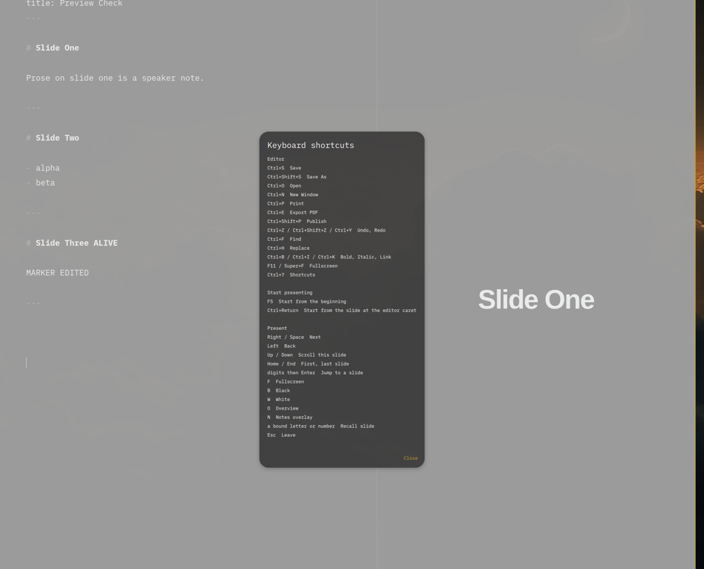

# Omapresent

[](LICENSE)
[](https://omarchy.org)
[](https://github.com/jethrojones/omapresent)

A dead-simple, Markdown-only presentation app for Omarchy. Open any Markdown file and it is already a presentation. No styling, no slide masters, no layout fiddling — the structure of your writing *is* the deck.

It is built for Omarchy and also runs on macOS from the same source. See [Install on macOS](#install-on-macos).

<!-- Screenshot placeholder -->
<p align="center">
  
</p>

## Start a presentation

Open a deck in Omapresent. Then choose one path:

- Press `F5` to start from the beginning.
- Press `Ctrl+Return` to start from the current editor slide.
- Click `Present` in the footer to start from the current editor slide.
- From a terminal, run `omapresent present FILE` to start the deck.

## Screen sharing on Omarchy and Hyprland

The editor and audience are separate native windows. In the editor, click the footer `Present` button to start from the current editor slide.

For a call or recording, share the audience window. If presentation is already running, choose the window source titled `<deck title> — Omapresent`, or `Omapresent` when no deck title is set. Do not choose `aquamarine - WAYLAND-1`; that is the outer compositor/output. The share portal may show its own label. Omapresent does not control that label.

---

## Highlights

- **The Markdown is the source of truth.** Any `.md` file is a valid presentation. A file without separators is one long scrollable slide.
- **You never style anything.** It is beautiful by default because it inherits your desktop Omarchy theme (`colors.toml`). There are no color or font dials.
- **Writing structure = slide structure.**
  - Headings, indented outlines, lists, code, tables, block quotes, math, and media are what the **audience** sees.
  - Plain paragraph prose is automatically extracted as **speaker notes** (visible only in the presenter view and web subtitles).
- **Readable text stays readable.** Omapresent keeps your chosen text size. It does not shrink a crowded slide to fit.
- **Tall slides scroll.** If a slide is taller than the audience window, that slide gets vertical scrolling. The audience mirrors the presenter's scroll position.
- **Bento layouts & rich media.** Consecutive images automatically tile into CSS Bento grids. Bare video URLs (YouTube, Vimeo, etc.) become interactive players; other bare URLs become scannable QR codes with captions.
- **Dual-window present mode.** Automatically routes the audience view fullscreen to external monitors while giving you a dedicated presenter cockpit (notes, timer, clock, next-slide preview, recall keys).
- **Rapid recall uses QWERTY keys.** Tag a separator (`--- {q}`) to bind the next slide to `Q`. Press `Q` to show it. Press `Q` again, `Space`, or `Esc` to return to the exact slide, fragment, and scroll position.
- **A live terminal on a slide.** Tag a separator (`--- {terminal}`) and that slide is your real shell, on the audience screen, at a size the room can read. `Shift+Esc` hands the keyboard back to the slides. See [A live terminal in the deck](#a-live-terminal-in-the-deck).
- **Export & Pluggable Publish.** Export pixel-identical PDFs (`Ctrl+E`) or publish static web bundles (`Ctrl+Shift+P`) with both interactive slide and long-read article formats via `here.now`, S3/B2, or custom shell commands.

---

## A live terminal in the deck

Tag a slide separator with `terminal` and, in present mode, that slide is a real terminal running your own shell. Run a REPL, an editor, or a coding agent in front of the room.

```markdown
--- {terminal}

# Live demo

Run the tests, then start the agent.
```

It uses the same tag as recall slides, so the two combine:

| Separator | What you get |
| :--- | :--- |
| `--- {terminal}` | A terminal slide in the normal flow |
| `--- {t, terminal}` | The same, and `T` pops it over any slide |
| `--- {t, terminal, skip}` | Only by pressing `T`. The arrow keys never land on it |

How it behaves:

- **Arriving on a terminal gives it the keyboard.** Every key goes to the shell, plain `Esc` included.
- **`Shift+Esc` gives the keyboard back.** A terminal popped by its key closes and you are back on the slide you left. A terminal slide in the flow stays on screen and the arrow keys drive the talk again.
- **`Enter` types in it again.** So does a click on the terminal.
- **The presenter window always says who has the keyboard.** On one screen the audience window says it for a few seconds each time it changes. A thin accent line along the top of the terminal is on while the shell has the keyboard.
- **One shell for the whole talk.** It starts the first time a terminal is shown, in the deck's folder. Every terminal slide shows that same session, so what you ran is still there when you come back. It ends when you leave present mode.
- **The audience screen sets the size.** About 100 columns at the default type size. The presenter window mirrors the same grid, smaller.
- **Type size:** `Cmd+=` and `Cmd+-` on macOS, `Ctrl+=` and `Ctrl+-` on Linux. `Cmd+0` or `Ctrl+0` resets it.
- **Scrollback:** `Shift+PgUp` and `Shift+PgDn`.
- **`Shift+Enter` sends Esc-Return**, which shells and coding agents read as a new line.
- **If the shell exits**, press `Enter` for a new one.

Only in present mode. The editor preview, a PDF and a published deck have no shell, so a terminal slide shows its own Markdown there. Write on it what a reader should see instead. In present mode that Markdown is covered by the terminal, and its plain paragraphs are still your speaker notes.

A deck cannot run a command for you. It can only open a prompt, and only when you put that slide on screen.

Not there yet: copying text out of the terminal on Linux.

---

## Control the talk from your phone

Omapresent can serve a small remote-control page to your phone while you
present. It needs [Tailscale](https://tailscale.com) on the computer and the
phone.

Turn it on once in `~/.config/omapresent/settings.toml`:

```toml
[presentation]
remote = true
```

Start presenting. The address is printed to the terminal and looks like
`http://100.x.y.z:4747/<token>/`. Open it on the phone and add it to the home
screen. The address stays the same from talk to talk.

The page shows the slide number, the heading, your speaker notes and the
timer. It has a large **Next** button, a smaller **Previous**, **All slides**
to jump to any slide, one button for each recall slide, and **Black** and
**White**.

It listens only while a talk is running, only on the computer's Tailscale
address, and only for requests that carry the token in
`~/.config/omapresent/remote-token`. Delete that file to get a new address.
The remote cannot type into a terminal slide, open a file or end the talk.

## Installation

### Install from Omarchy

Omapresent is in the official Omarchy package repository. Install it with:

```bash
omarchy pkg add omapresent
```

### Install a GitHub Release Package

Use this path when you need to install the package file directly.

1. Open the [latest GitHub release](https://github.com/jethrojones/omapresent/releases/latest).
2. Download the `omapresent-*-x86_64.pkg.tar.zst` file.
3. Install the file you downloaded:

```bash
sudo pacman -U ./omapresent-VERSION-1-x86_64.pkg.tar.zst
```

Replace `VERSION` with the version in the downloaded file name.

### Build from Source

This path uses the source repository. It does not use a GitHub release package.

```bash
git clone https://github.com/jethrojones/omapresent.git
cd omapresent
./bin/build
./build/omapresent
```

To install the source build as an Arch package, run:

```bash
./bin/install
```

### Install on macOS

You need [Homebrew](https://brew.sh). Then, from a clone of this repository:

```bash
./bin/install
```

On a Mac that runs `bin/install-macos`, which:

- installs the Qt modules it needs from Homebrew, if they are missing
- installs the iA Writer fonts from Homebrew, if they are missing
- builds the app
- puts `Omapresent.app` in `~/Applications`
- puts an `omapresent` command in `~/.local/bin`

Nothing needs `sudo`. Then:

```bash
omapresent talk.md            # open a deck in the editor
omapresent present talk.md    # open it and start presenting
open -a Omapresent talk.md    # the same as double-clicking it in Finder
```

What is different on a Mac:

- **`Ctrl` in this README is `Cmd`.** `Cmd+S` saves, `Cmd+Return` presents from the current slide. `Super+F` is `Ctrl+F`.
- **The presenter view goes on the laptop's own screen** and the audience window on the external display, whichever one has the menu bar.
- **`F` fullscreens the audience window** on the display it is on. `F11` belongs to macOS.
- **No Omarchy theme.** The deck uses the built-in dark or light palette, following the system appearance. A `colors.toml` at `~/.local/state/omarchy/current/theme/` is still read if you put one there.
- **Do Not Disturb is yours to switch on.** macOS gives apps no way to do it. The display is kept awake for you.
- **Settings are in the same place:** `~/.config/omapresent/settings.toml`.
- **The app uses Homebrew's Qt**, like the Arch package uses the system's. It is not a self-contained bundle to copy to another Mac.

To remove it:

```bash
./bin/install-macos --uninstall
```

### Uninstall

If Omarchy installed the package, run:

```bash
omarchy pkg drop omapresent
```

If you installed from this checkout with `./bin/install`, remove the package it
created:

```bash
sudo pacman -Rns omapresent
```

These commands remove the Omapresent package. They preserve your Markdown decks
and user settings in `~/.config/omapresent/settings.toml`.

### Dependencies
- Runtime: `hicolor-icon-theme`, `qt6-base`, `qt6-declarative`,
  `qt6-webengine`, `qt6-webchannel`, `qt6-multimedia`,
  `xdg-desktop-portal`, and `ttf-ia-writer`
- Build only: `imagemagick`
- The package does not use GStreamer or bundle fonts. QtWebEngine supplies the
  HTML video path, and the iA Writer S fonts come from the system package.
- macOS (Homebrew): `qtbase`, `qtdeclarative`, `qtwebengine`, `qtwebchannel`,
  `qtmultimedia`, `qtsvg`, `qtimageformats`, and the casks
  `font-ia-writer-mono`, `font-ia-writer-quattro`, `font-ia-writer-duo`.
  `bin/install-macos` installs all of them.
- The live terminal needs nothing extra on either platform. xterm.js is
  vendored in `src/terminal/vendor/` and compiled into the app.

---

## Keyboard Reference

### Editor Shortcuts
| Shortcut | Action |
| :--- | :--- |
| `Ctrl+S` | Save (opens portal picker for untitled files) |
| `Ctrl+Shift+S` | Save As |
| `Ctrl+O` | Open file |
| `Ctrl+N` | New window |
| `Ctrl+P` | System print dialog |
| `Ctrl+E` | Export PDF slides |
| `Ctrl+Shift+P` | Publish presentation to web |
| `Ctrl+Z` / `Ctrl+Shift+Z` / `Ctrl+Y` | Undo / Redo |
| `Ctrl+F` | Find in document (`Enter` next, `Shift+Enter` previous) |
| `Ctrl+H` | Find & Replace |
| `Ctrl+B` / `Ctrl+I` / `Ctrl+K` | Insert bold / italic / link Markdown |
| `Super+F` | Toggle editor fullscreen |
| `F5` | Start from the beginning |
| `Ctrl+Return` | Start from the current editor slide |
| `Ctrl+?` | Shortcut reference sheet |

### Present Mode Shortcuts
| Shortcut | Action |
| :--- | :--- |
| `Space` / `→` | Next fragment or advance slide |
| `←` | Previous fragment or step back |
| `↑` / `↓` / `PgUp` / `PgDn` / `Wheel` | Scroll current slide (mirrored on audience display) |
| `Home` / `End` | Jump to first or last slide |
| `Digits` + `Enter` | Jump directly to slide number |
| `F` | Toggle fullscreen (audience window) |
| `B` / `W` | Black out / White out audience display (toggle) |
| `O` | Toggle slide overview grid |
| `N` | Toggle presenter notes overlay (single-monitor mode) |
| *Bound Key (e.g. `Q`)* | Toggle recall overlay slide |
| `Shift+Esc` | Leave a live terminal. A popped terminal closes; a terminal slide stays up |
| `Enter` | On a terminal slide: type in the terminal again |
| `Esc` | Exit presentation mode |
| `Ctrl+?` | Shortcut reference sheet |

On macOS, read `Ctrl` as `Cmd`.

---

## Credits & License

Omapresent is open-source software licensed under the **MIT License**.

Started from the foundation of **Omawrite** by David Heinemeier Hansson (© 2026 David Heinemeier Hansson). Extended and adapted for presentations by Jethro Jones (© 2026 Jethro Jones). See `LICENSE` and `NOTICE` for details.
